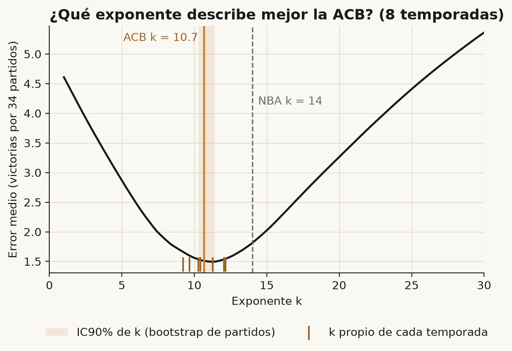
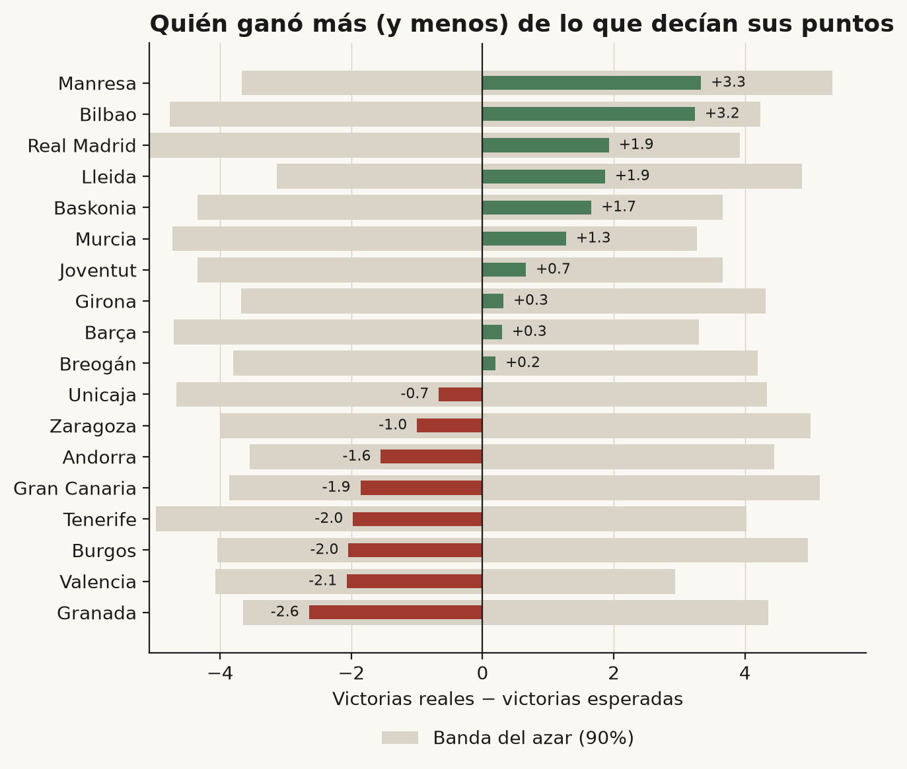
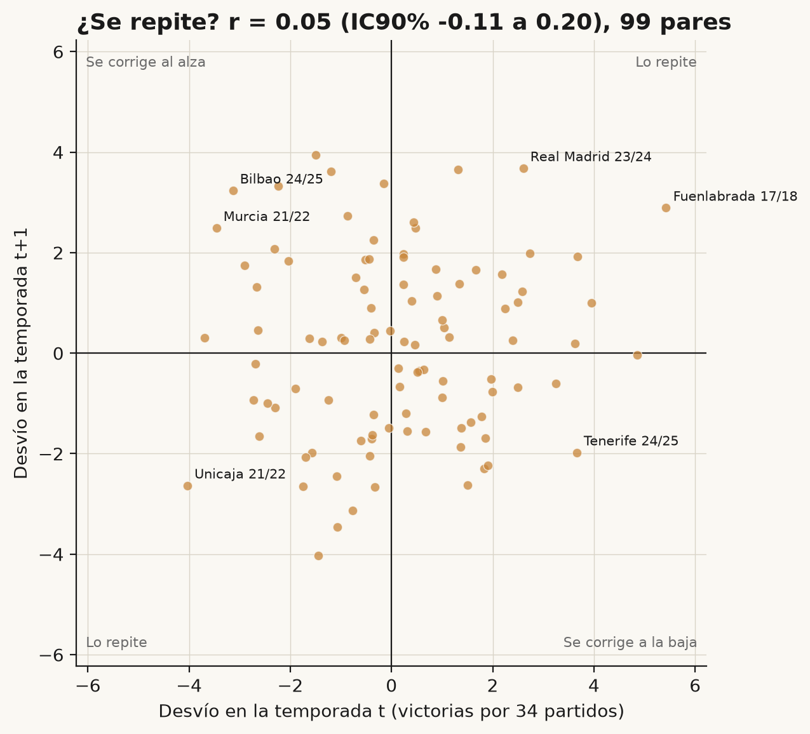
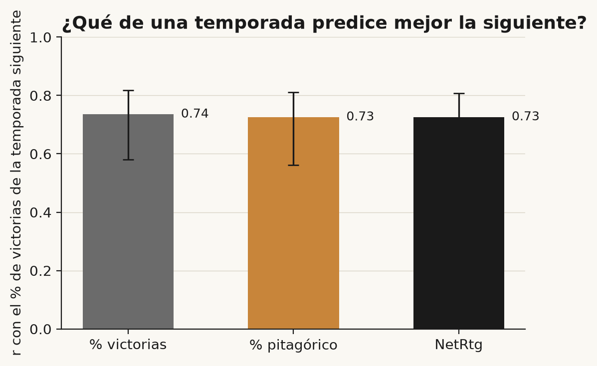

BAXI Manresa ganó 16 partidos en la fase regular 2025/26. Sus puntos a favor y en contra eran los de un equipo de unas 12,7 victorias: +3,3 sobre lo esperado, el mayor desvío positivo de la liga. En el extremo opuesto, Coviran Granada se quedó en seis victorias cuando sus puntos valían 8,6.

La pregunta es qué hay detrás. Si ganar por encima de lo que dicen los puntos fuera una habilidad (cerrar bien los finales igualados, por ejemplo), los mismos equipos deberían repetirlo de un año a otro. Si es ruido de 34 partidos, no. Una temporada no permite distinguirlo, así que aquí se usan ocho. De paso sale un exponente propio para la ACB: 10,7, frente al 14 de la NBA.

## La expectativa pitagórica

Bill James observó en el béisbol que el balance de un equipo se parece mucho a la proporción de carreras que anota y encaja. Daryl Morey llevó la idea al baloncesto:

> % de victorias esperado = PF^k / (PF^k + PC^k)

PF son los puntos a favor, PC los puntos en contra y k un exponente que cambia con el deporte. En béisbol ronda 2; el valor que se cita para la NBA es 14. En baloncesto es tan alto porque cada partido reúne muchas posesiones y, con tantas, el mejor equipo gana con más regularidad: una ventaja pequeña de puntos se convierte en muchas victorias. Es la explicación habitual, y este artículo no la pone a prueba.

Las victorias esperadas son los partidos jugados por ese porcentaje. El desvío es la diferencia entre victorias reales y esperadas, siempre expresado por 34 partidos.

## Datos y reglas

Los datos son la fase regular de la ACB de 2017/18 a 2025/26, sin la 2019/20, que quedó incompleta por la pandemia. Quedan ocho temporadas y 145 equipos-temporada. Las reglas se fijaron antes de mirar los resultados:

- k se calibra sin la temporada que se evalúa: cada desvío se mide con un k ajustado con las otras siete.
- El test principal es la correlación entre el desvío de un equipo en una temporada y el de la siguiente, con intervalo de confianza al 90% por *bootstrap* sobre clubes.
- Si el límite inferior de ese intervalo supera 0, se considera que el desvío se repite. Si no, no se detecta repetición.
- Partido igualado, como en la NBA: margen de 5 puntos o menos, o prórroga. Solo se usa para describir.

## Calibrar k para la ACB

El k que mejor ajusta las ocho temporadas es 10,7, con un intervalo al 90% de 10,3 a 11,4.

Se sostiene fuera de muestra. Dejando cada temporada fuera y calibrando con las otras siete, el error medio es de 1,53 victorias por equipo, frente a 1,81 con el 14 de la NBA. El k propio gana en 6 de las 8 temporadas. En la 25/26 el 14 rindió algo mejor: 1,55 frente a 1,59.

## La 25/26, equipo por equipo

Con k calibrado sin la 25/26 (10,6), cada equipo tiene sus victorias esperadas. Para saber cuánto desvío cabe por azar se simularon 10.000 temporadas partido a partido sobre el calendario real, con la fuerza pitagórica de cada equipo y la ventaja de campo observada. La banda del azar son los percentiles 5 a 95 de esas simulaciones.

Ningún equipo sale de la banda. El desvío de Manresa, el mayor de la temporada, es compatible con el azar.

Tabla completa de la 25/26

| Equipo | V | Esperadas | Desvío | Banda del azar (90%) |
|---|---:|---:|---:|---:|
| Manresa | 16 | 12,7 | +3,3 | 9 – 18 |
| Bilbao | 19 | 15,8 | +3,2 | 11 – 20 |
| Real Madrid | 26 | 24,1 | +1,9 | 19 – 28 |
| Lleida | 12 | 10,1 | +1,9 | 7 – 15 |
| Baskonia | 25 | 23,3 | +1,7 | 19 – 27 |
| Murcia | 25 | 23,7 | +1,3 | 19 – 27 |
| Joventut | 22 | 21,3 | +0,7 | 17 – 25 |
| Girona | 14 | 13,7 | +0,3 | 10 – 18 |
| Barça | 24 | 23,7 | +0,3 | 19 – 27 |
| Breogán | 15 | 14,8 | +0,2 | 11 – 19 |
| Unicaja | 17 | 17,7 | −0,7 | 13 – 22 |
| Zaragoza | 10 | 11,0 | −1,0 | 7 – 16 |
| Andorra | 10 | 11,6 | −1,6 | 8 – 16 |
| Gran Canaria | 10 | 11,9 | −1,9 | 8 – 17 |
| Tenerife | 18 | 20,0 | −2,0 | 15 – 24 |
| Burgos | 12 | 14,0 | −2,0 | 10 – 19 |
| Valencia | 25 | 27,1 | −2,1 | 23 – 30 |
| Granada | 6 | 8,6 | −2,6 | 5 – 13 |

Los partidos igualados ayudan a describir, no a explicar. Manresa fue 6-4 en ellos, Bilbao 8-5 y Lleida 4-4; Tenerife, con desvío negativo, 5-7, y Valencia, también por debajo de sus puntos, 5-3. Entre los 18 equipos, el desvío y el balance en igualados se parecen (correlación de 0,69), algo esperable porque el desvío se construye con las victorias que los puntos no explican. Lo que no dice es si esos finales se ganan por saber o por suerte.

## ¿Se repite?

Si ganar por encima de los puntos fuera una habilidad, los equipos con desvío positivo un año deberían mantenerlo al siguiente.

Con las ocho temporadas hay 99 pares: el mismo club en dos temporadas consecutivas completas. La correlación es r = 0,05, con un intervalo al 90% de −0,11 a +0,20. La pendiente cuenta lo mismo: de cada victoria de desvío, se mantiene alrededor de 0,05. Las correlaciones de cada paso de temporada van de −0,27 a +0,27, con 16 o 17 pares cada una, es decir, ruido. Sin la 2020/21, r = 0,02.

El límite inferior del intervalo (−0,11) no supera 0, así que la conclusión, según la regla fijada, es que con ocho temporadas de la ACB no se detecta que el desvío se repita de una temporada a la siguiente. Con esta muestra, un efecto moderado (r ≈ 0,25 o más) se habría detectado con alta probabilidad, de modo que es improbable que exista. Un efecto pequeño no se puede descartar.

Dos lecturas adicionales, sin regla de decisión previa. El porcentaje de victorias en partidos igualados de un año frente al siguiente da r = 0,13 (−0,07 a +0,30), también compatible con cero, aunque el intervalo no excluye un efecto pequeño. Y en la 25/26, el desvío de la primera mitad frente al de la segunda da r = −0,01.

## Lo que el análisis no dice

Los finales se entrenan: hay jugadas específicas, decisiones de tiempos muertos y gestión de faltas. Este análisis no dice lo contrario. Dice algo más acotado: si ese trabajo deja huella en el balance, es pequeña o no se detecta con 99 pares.

Antes de empezar sospechaba que el NetRtg (diferencial por 100 posesiones) predeciría mejor que los puntos brutos. Con los datos de un año, la correlación con el % de victorias del siguiente es de 0,74 para el % de victorias, 0,73 para el pitagórico y 0,73 para el NetRtg.

Las diferencias son de una o dos centésimas y sus intervalos incluyen el cero, así que no puede decirse que el pitagórico ni el NetRtg predigan mejor que el balance de victorias. Mi interpretación, que no he contrastado, es que el nivel de los equipos y los cambios de plantilla pesan mucho más que las dos victorias de ruido por temporada, y que ese ruido es lo único que corregirían ambas métricas.

Los límites. Son 99 pares y ocho temporadas, así que un efecto de r ≈ 0,1 sigue sin poder detectarse. Plantillas y entrenadores cambian de un año a otro, y eso por sí solo limita cuánto puede repetirse. El k varía entre temporadas, de 9,2 a 12,2. Las posesiones están estimadas con la fórmula estándar, no contadas. La 2019/20 queda fuera y la 2020/21 es atípica, con 19 equipos. Y la banda del azar es más ancha de lo que piden los datos: en las ocho temporadas solo 2 de 145 equipos-temporada salieron de ella, cuando por construcción se esperaría en torno al 10%. Por eso «ningún equipo sale de la banda» es una afirmación más débil de lo que parece.

## Predicción para la 26/27

Si el desvío es sobre todo ruido, los equipos deberían acercarse en la 26/27 a lo que dicen sus puntos. Con la pendiente medida, solo se mantendría un 5% del desvío de la 25/26. Con los datos hasta esa temporada, los cuatro equipos con mayor desvío positivo deberían bajar hacia sus puntos: Manresa (de 16 victorias a unas 12,7), Bilbao (de 19 a 15,8), Real Madrid (de 26 a 24,1) y Lleida (de 12 a 10,1). Los tres con mayor desvío negativo deberían subir: Valencia (de 25 a 27,1), Burgos (de 12 a 14,0) y Tenerife (de 18 a 20,0).

Esto mide la distancia entre victorias y puntos en la 25/26. No es un pronóstico del balance de la 26/27, porque las plantillas cambian. En enero lo revisaré con el mismo método, sin retocarlo.

## Recurso y código

La tabla de victorias esperadas de las ocho temporadas (145 equipos-temporada, con sus bandas del azar) está en CSV para los suscriptores de la newsletter de Basketmática. Si ya estás suscrito, la tienes en el correo de esta edición. Si no, [suscríbete](https://basketmatica.beehiiv.com) y te llegará en el correo de bienvenida.

El código es público y reproducible, con los datos de partido incluidos. [Link al repositorio en GitHub](https://github.com/Basketmatica/basketmatica-expectativa-pitagorica). El notebook (`notebooks/metodo.ipynb`) reproduce todas las cifras de este artículo; las reglas, su cronología y el detalle metodológico están en `docs/`. Los datos de partido proceden de acb.com.

## Cierre

Con ocho temporadas de la ACB, ganar más de lo que dicen los puntos no se repite de un año al siguiente, y los finales igualados no cambian esa lectura. Hasta donde alcanzan los datos, Manresa y Bilbao ganaron en 2025/26 más de lo que sus puntos merecían, y no hay motivo para esperar que lo repitan. En enero se verá si el método acierta.
